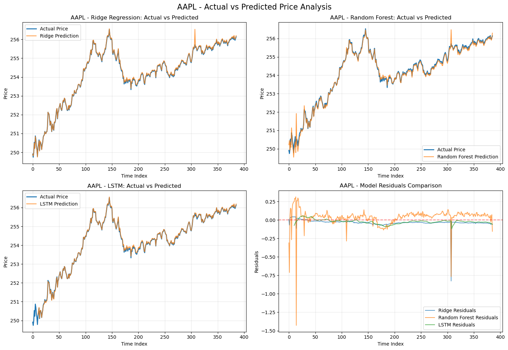
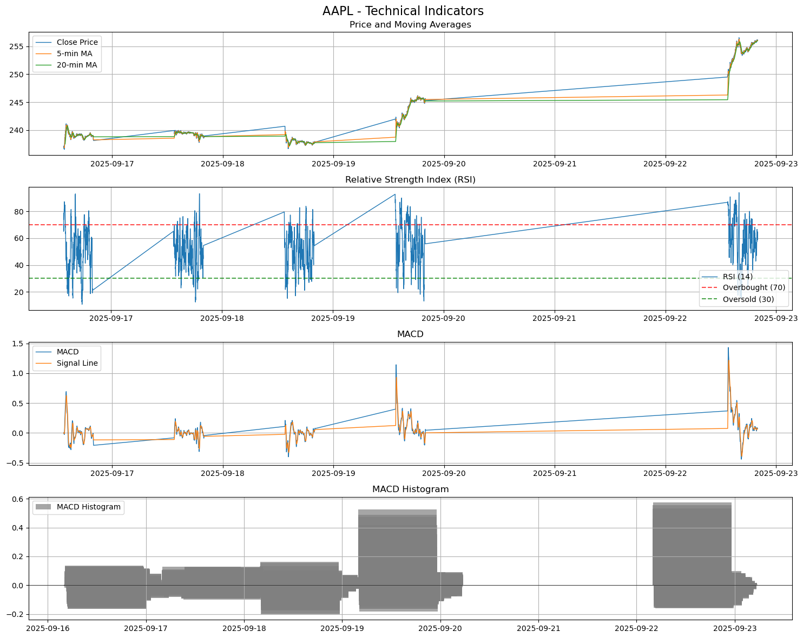
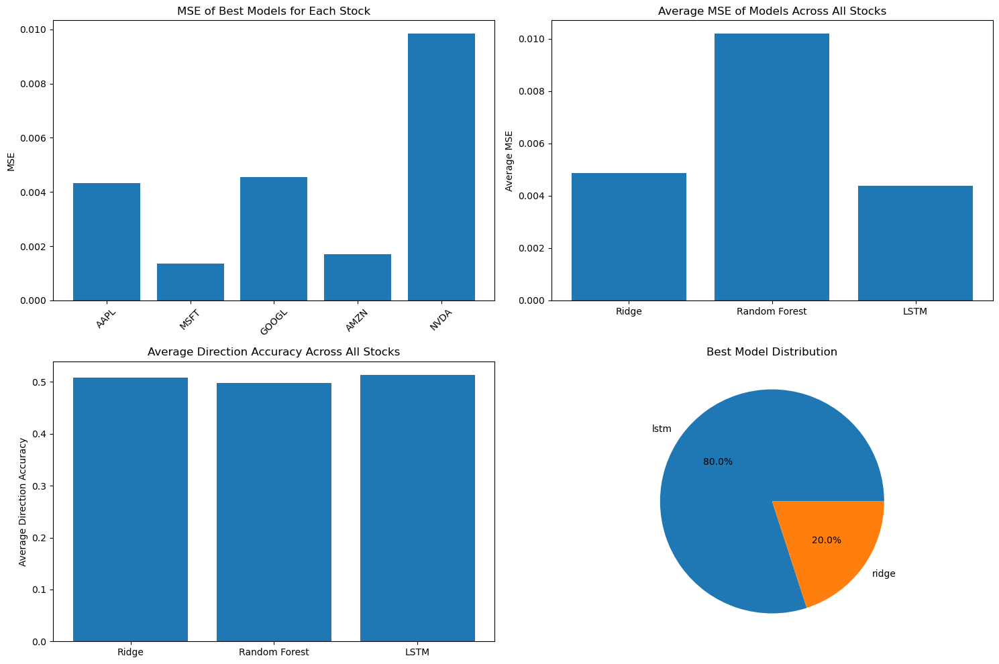

# Intraday (1-Minute) Stock Price Prediction

Predicts the **next-minute % price change** for five large-cap tech stocks (AAPL, MSFT, GOOGL, AMZN, NVDA) from 1-minute bars, comparing **Ridge regression, Random Forest and an LSTM**. Built during my Data Analyst internship at **Mechcraft-tech** (Sep 2025).



## Pipeline

1. **Data:** 5 trading days of 1-minute OHLCV from Yahoo Finance (`yfinance`); rows with missing values dropped
2. **Features:** 5- and 20-minute moving averages, RSI(14), MACD(12, 26, 9) with its signal line and histogram, plus raw OHLCV
3. **Target:** next-minute close-to-close % change
4. **Split:** chronological 80/20 train/test; `StandardScaler` fitted on the training set only
5. **Models:**
   - Ridge, with alpha tuned by `GridSearchCV`
   - Random Forest with 100 trees
   - 2-layer LSTM (50 → 50 units, 20% dropout) on sequences of 10 minutes
6. **Metrics:** MSE, MAE, R² and directional accuracy; the best model is picked per ticker by MSE



## Results (test set)

| Ticker | Best model | MSE | Direction accuracy (best of 3 models) |
|---|---|---|---|
| AAPL | LSTM | 0.0043 | 54.7% (Ridge) |
| MSFT | LSTM | 0.0014 | 52.3% (Ridge) |
| GOOGL | LSTM | 0.0046 | 53.9% (Random Forest) |
| AMZN | Ridge | 0.0017 | 50.3% (LSTM) |
| NVDA | LSTM | 0.0098 | 51.3% (Random Forest) |



**What the results say:** the LSTM had the lowest MSE on 4 of 5 stocks. Even so, test R² was close to or below zero for every model, and directional accuracy stayed around 50–55%. Next-minute returns are close to unpredictable from price-based indicators alone. The pipeline is still useful as a reproducible baseline for testing new features, but it is not a ready-to-trade signal.

## Run it

```bash
pip install -r requirements.txt
jupyter notebook intraday_price_prediction.ipynb   # or: python intraday_price_prediction.py
```

Yahoo Finance only serves 1-minute data for the most recent ~7 days, so a new run uses different data and gives different numbers.

## Files

| File | Description |
|---|---|
| `intraday_price_prediction.ipynb` | Full notebook with outputs and charts |
| `intraday_price_prediction.py` | Script version |
| `report.pdf` | Written report: methodology, features, models, evaluation and recommendations |
| `images/` | Charts used in this README |

## Next steps

- Use time-series cross-validation (`TimeSeriesSplit`) instead of k-fold for tuning
- Standardize features across all stocks and pool the training data
- Add order-flow and volume features, and test on a longer history
